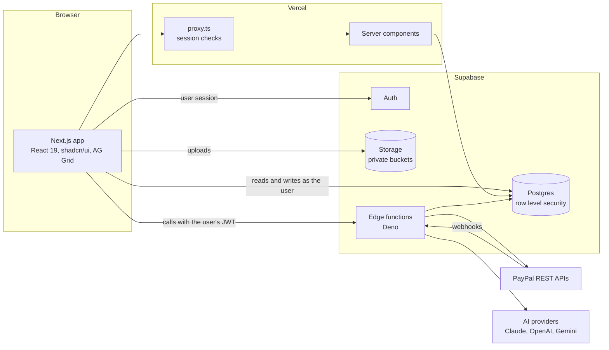
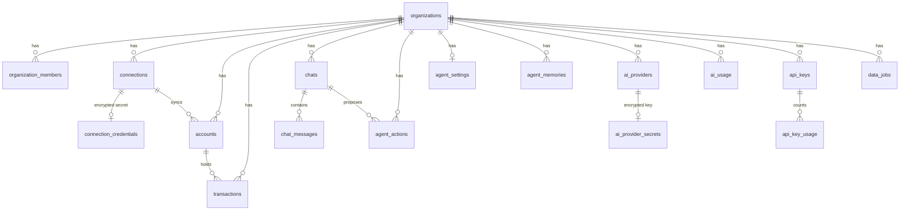
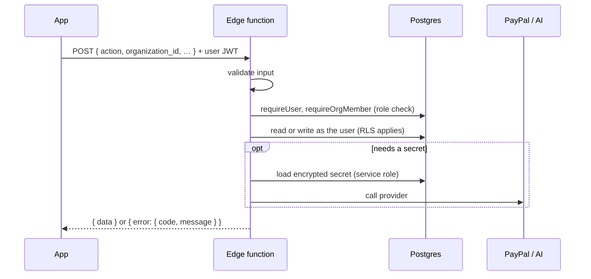
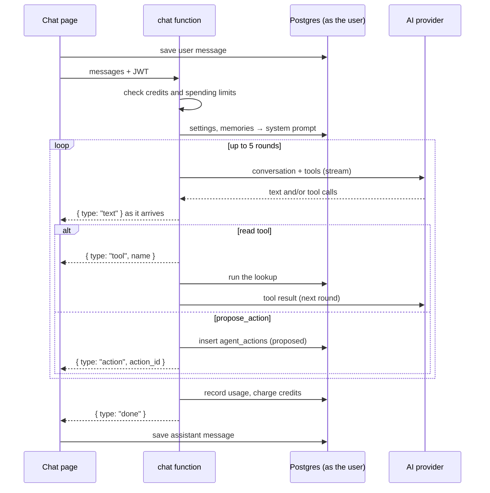
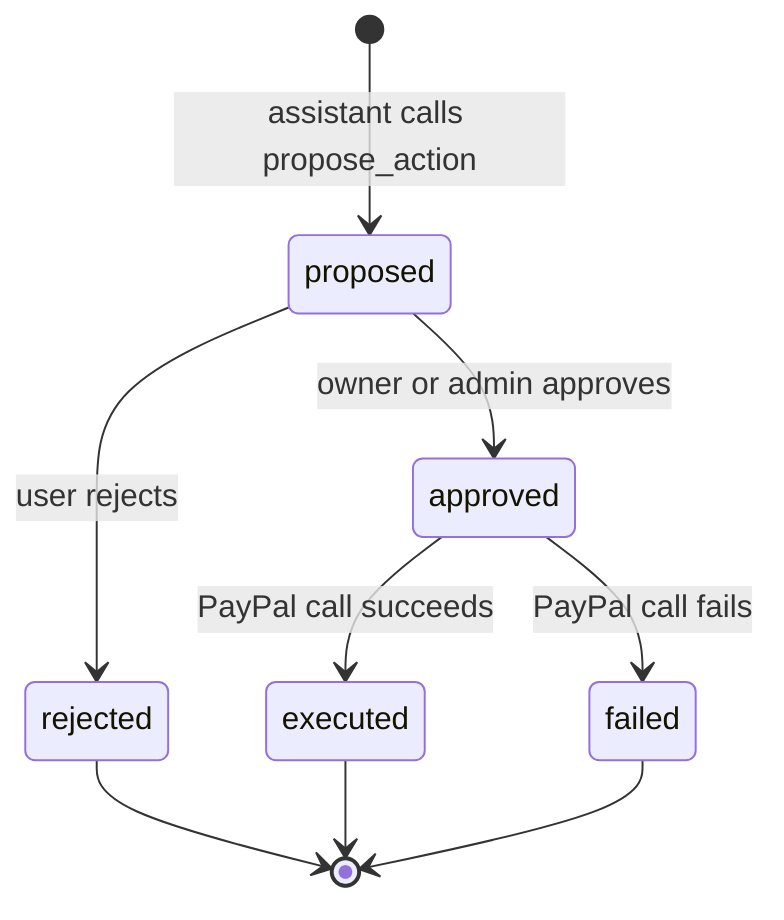
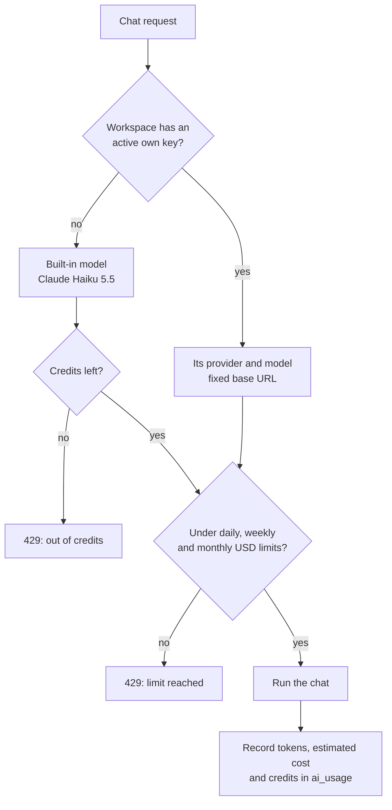

# Architecture

This document explains how Finobots is put together: the pieces, how data moves between them, and the rules that keep each workspace's data safe. For set-up steps, see the [README](../README.md) and the [Contributing Guide](../CONTRIBUTING.md).

## Contents

- [Overview](#overview)
- [Front end](#front-end)
- [Sessions and authentication](#sessions-and-authentication)
- [Database](#database)
- [Edge functions](#edge-functions)
- [The chat assistant](#the-chat-assistant)
- [Approvals](#approvals)
- [PayPal](#paypal)
- [AI models, credits and limits](#ai-models-credits-and-limits)
- [Security model](#security-model)
- [Design decisions](#design-decisions)

## Overview



There are three layers:

1. **The Next.js app** renders pages and talks to Supabase directly with the signed-in user's session.
2. **Supabase** holds the data, enforces access with row level security, stores files and runs edge functions.
3. **Edge functions** do anything that needs a secret or an external API: chat, PayPal calls, approvals and credential storage.

The browser never holds a secret. It only has the Supabase URL and the publishable key.

## Front end

### Stack

- Next.js 16 App Router with `cacheComponents` on. Server components by default; client components only where there's interaction.
- Tailwind CSS v4, shadcn/ui (base-nova) on Base UI primitives, Lucide icons.
- AG Grid Community for data tables, through one wrapper in `components/ui/data-grid.tsx`.

### Routes

| Route | Purpose |
| --- | --- |
| `/` | Landing page |
| `/auth/*` | Log in, sign up, forgot and reset password; `/auth/callback` exchanges email and OAuth codes |
| `/legal/*` | Terms, privacy, cookies |
| `/console/chat`, `/console/chat/[chatId]` | New chat, chat session |
| `/console/recents` | Previous chats |
| `/console/accounts`, `/console/accounts/[accountId]` | Accounts, one account |
| `/console/transaction`, `/console/transaction/[recordId]` | Ledger, one transaction |
| `/console/cashflow` | Cash flow |
| `/console/connections`, `/console/connections/[connectionId]` | Connections, one connection |
| `/console/settings/*` | Profile, personalization, usage, data, security, notifications, API |

### Layout

The console is pinned to the viewport (`fixed inset-0`). The sidebar stays put and only `<main>` scrolls. Settings open as a dialog over the console. The chat page fills `<main>` edge to edge, so its message list scrolls with the scrollbar at the right of the screen and the input stays at the bottom.

### Data access

Most pages read and write through Supabase directly, as the user:

```ts
const { data } = await createClient().from("accounts").select("…").eq("organization_id", orgId);
```

Row level security decides what comes back, so the client can't see another workspace's data even if it asks.

Anything that needs a secret goes through an edge function:

```ts
const { data, error } = await callFunction<Result>("accounts", { action: "sync", organization_id });
```

`callFunction` (in `lib/client.ts`) unwraps the `{ data }` reply and turns `{ error }` into a message.

### Shared page state

A page's cards often show the same data. Two small helpers in `lib/client.ts` let them share it without each fetching:

- `createResource(loader)` loads once, shares the result, reloads after 30 seconds or on `reload()`.
- `createStore(initial)` holds shared values such as the selected row or the filters.

Each area keeps its resource in one file:

| Area | File |
| --- | --- |
| Accounts | `components/pages/console/accounts/listing.tsx` |
| Transactions | `components/pages/console/transactions/ledger.tsx` |
| Cash flow | `components/pages/console/cashflow/overview.tsx` |
| Connections | `components/pages/console/connections/connected.tsx` |

Detail pages (`[accountId]`, `[recordId]`, `[connectionId]`) select their item in the shared store, so they reuse the same cards. A transaction is loaded by id, so its page opens even when it's outside the ledger's filters.

## Sessions and authentication

- Email and password with confirmation, plus optional "Continue with PayPal" through a Supabase custom OAuth provider.
- `proxy.ts` runs on `/console/*`. It refreshes the Supabase session and applies the session policy in `lib/auth/session.ts`:
  - 1 day, or 30 days with **Remember me**
  - signed out after 1 day without activity
  - tracked with HTTP-only cookies `fb_session` and `fb_active`, alongside Supabase's own `sb-*` cookies
- Optional authenticator-app two-factor (Supabase MFA, TOTP).
- The profile shown in the sidebar is read on the server with `"use cache: private"`, so it's never shared between users.

## Database

### Workspaces and isolation

Each user gets exactly one workspace (an organisation) when they sign up. Every business table carries `organization_id`, and row level security policies check membership with `is_org_member()` and roles with `has_org_role()`. The browser finds its workspace with the `my_workspace()` function.



### Tables

| Group | Tables | Notes |
| --- | --- | --- |
| People | `profiles`, `organizations`, `organization_members` | One workspace per user |
| Money | `connections`, `accounts`, `transactions` | Amounts are signed: positive in, negative out. Accounts hold one currency each |
| Secrets | `connection_credentials`, `ai_provider_secrets` | RLS on, no policies, client privileges revoked: service role only |
| Chat | `chats`, `chat_messages`, `agent_actions` | Chats and messages are private to their owner |
| Assistant | `agent_settings`, `agent_memories`, `ai_providers` | Tone, length, instructions, spending limits, memories, own keys |
| Usage | `ai_usage`, `ai_credits` | Written only by server code |
| Other | `notification_preferences`, `api_keys`, `api_key_usage`, `data_jobs` | API keys are stored as SHA-256 hashes |

### Storage

All buckets are private.

| Bucket | Path | Used for |
| --- | --- | --- |
| `avatars` | `<user_id>/…` | Profile pictures |
| `user-uploads` | `<user_id>/…` | Receipts |
| `workspace-files` | `<org_id>/…` | Imports and exports |

### Migrations

Everything, including policies, helper functions and buckets, lives in `supabase/migrations/`. New changes go in new files; applied migrations are never edited.

## Edge functions

Functions live in `supabase/functions/` and share helpers from `_shared/`:

| Helper | Does |
| --- | --- |
| `auth.ts` | `requireUser`, `requireOrgMember` (with optional roles) |
| `database.ts` | User and admin clients, encrypted credential and key storage |
| `validation.ts` | Input checks: types, lengths, UUIDs, currencies, dates |
| `response.ts` | `json()` replies and `HttpError` |
| `cors.ts` | CORS limited to `ALLOWED_ORIGINS` |
| `paypal.ts` | PayPal client per connection |
| `ai.ts` | Provider targets, cost estimates and credits |

Every function follows the same pattern:



| Function | Actions | Who |
| --- | --- | --- |
| `chat` | Streams a reply; runs read tools; proposes actions | Any member |
| `actions` | `approve`, `reject` | Owners and admins |
| `accounts` | `sync` | Owners and admins |
| `transactions` | `import`, `categorise`, `reconcile` | Import: owners and admins |
| `cashflow` | `summary`, `forecast` | Any member |
| `connections` | `connect`, `rotate`, `test`, `disconnect` | Owners and admins |
| `ai-providers` | `connect`, `use`, `use_default`, `remove` | Owners and admins |
| `api-keys` | Create a key | Owners and admins |
| `webhooks` | PayPal events | PayPal, signature verified |

## The chat assistant

The `chat` function streams Server-Sent Events back to the browser. The model can call read-only tools to look up the workspace's data, as the user, before it answers.



### Tools

| Tool | Answers |
| --- | --- |
| `get_accounts` | Accounts, balances, totals per currency |
| `get_account_details` | One account: totals, status counts, top categories and counterparties, latest transactions |
| `search_transactions` | Find and total transactions by date, status, direction, category, account, text and amount |
| `get_transaction` | One transaction in full |
| `get_cashflow` | In, out and net, grouped by month, week, category, counterparty or account, optionally without transfers |
| `get_forecast` | A simple balance projection for one currency |
| `get_connections` | Connected providers and sync status |
| `get_approvals` | Proposed actions and their status |
| `propose_action` | Send an invoice or reminder, pending approval |

Tool arguments come from the model, so every one is clamped or cleaned before it's used. Free text is reduced to plain characters before it reaches a query. Results are capped in size, and totals are always per currency.

### Prompt

The system prompt is built per request from:

1. Fixed rules: use tools, quote currencies, never invent figures, never claim an action has run.
2. Formatting rules: compact one-line items, at most 10, no tables.
3. Today's date.
4. The workspace's tone and length.
5. The workspace's custom instructions, labelled as preferences that can't override the rules.
6. Up to 20 memories.

## Approvals

The assistant can only propose. Running an action needs an owner or admin.



- Users can only change `status`, `decided_by` and `decided_at`, and only from `proposed`.
- The `actions` function reads the workspace from the stored action, not the request.
- It claims the action before calling PayPal, so two approvals at once can't send the same invoice twice.
- Only server code can mark an action `executed` or `failed`.

## PayPal

| Flow | API | Function |
| --- | --- | --- |
| Connect | OAuth client credentials, to verify | `connections` |
| Balances | Reporting: balances, one account per currency (`balance-<CUR>`) | `accounts` |
| Transactions | Reporting: transaction search, 31 days per call, fees as their own rows | `transactions` |
| Invoices and reminders | Invoicing, after approval | `actions` |
| Live events | Webhooks, verified with PayPal before saving | `webhooks` |

Each workspace connects its own PayPal app. Its client secret is encrypted per connection, so one workspace can never act on another's PayPal account. Re-importing keeps the user's categories and reconciliation, because imports upsert on `(account_id, external_id)` without touching those fields.

## AI models, credits and limits



- **Built-in model:** Claude Haiku 5.5 through Anthropic's OpenAI-compatible API, with up to 1,024 tokens per round and the last 20 messages.
- **Credits:** 100 per user (an internal 5 USD budget), plus 5 a day up to 100. Only the built-in model uses them.
- **Own keys:** Claude, OpenAI or Gemini. Keys are tested, encrypted and never returned. Base URLs are fixed on the server, which rules out server-side request forgery.
- **Spending limits:** daily, weekly and monthly USD caps across every model. `0` means no limit.
- **Costs** are estimates from public token prices in `_shared/ai.ts`.

## Security model

| Concern | How it's handled |
| --- | --- |
| Seeing other workspaces' data | Row level security on every table, keyed on `organization_id` and membership |
| Leaking provider secrets | Encrypted with AES-256-GCM (row id as additional data), in service-role-only tables, never returned |
| The assistant acting on its own | Propose-only; owner or admin approval; each action runs once |
| Prompt injection through instructions | Custom instructions are labelled as preferences and placed after the rules |
| Unsafe tool arguments | Clamped numbers, allow-listed enums, cleaned text, capped results |
| Forged webhooks | Verified with PayPal before anything is written |
| Cross-site calls | CORS limited to `ALLOWED_ORIGINS` |
| Leaked API keys | Shown once, stored as SHA-256 hashes, revocable |
| Runaway AI costs | Credits, capped reply length, USD spending limits |
| Stale sessions | 1-day or 30-day lifetime, 1-day idle timeout, optional two-factor |

To report a vulnerability, see the [Security Policy](../SECURITY.md).

## Design decisions

- **One workspace per user.** Simpler sharing rules for now. The schema already has roles, so teams can be added later.
- **Browser reads go straight to Postgres.** Row level security makes this safe, and it avoids writing an API for every list.
- **Edge functions only where needed.** Secrets and external APIs stay on the server; everything else stays simple.
- **OpenAI-compatible chat API for every provider.** One code path for Claude, OpenAI and Gemini; switching is a base URL, key and model.
- **Read tools instead of stuffing data into the prompt.** The assistant fetches only what a question needs, which keeps prompts small and answers grounded.
- **Currencies are never mixed.** Every total is per currency, and nothing is converted.
- **Propose, then approve.** Anything with financial effect waits for a person.
